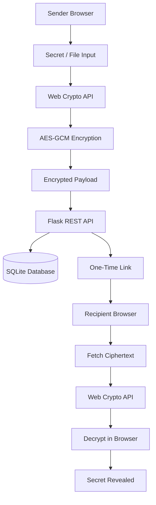
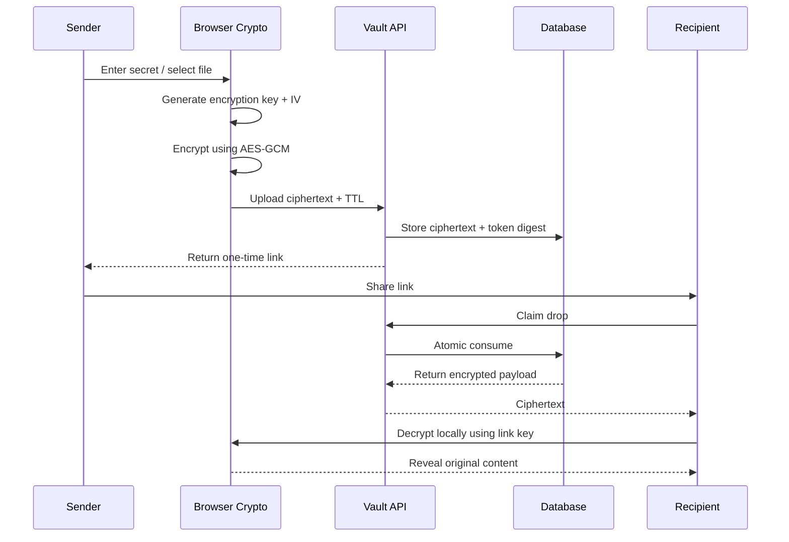

# 🔐 Dead-Drop Vault

<p align="center">
  <strong>Share secrets. Reveal once. Leave nothing accessible.</strong>
</p>

<p align="center">
  A privacy-focused, self-destructing secret and file sharing application that allows users to securely share sensitive information through one-time links.
</p>

<p align="center">
  
  
  
  
  
  
</p>

---

## 📌 Overview

Dead-Drop Vault is a lightweight, privacy-oriented application designed to eliminate the risks of sharing sensitive information through ordinary messaging platforms, emails, or persistent cloud documents.

Users can encrypt private text or files in their browser, generate a temporary shareable link, and allow a recipient to retrieve the content exactly once. After a successful claim, the stored encrypted payload is removed from the active database.

Unlike traditional file-sharing systems, Dead-Drop Vault is designed around **minimal exposure, short-lived access, and one-time retrieval**.

> Built as a security-focused project exploring browser-side cryptography, secure data handling, one-time access mechanisms, and privacy-aware application design.

## ✨ Features

| Feature | Description |
|---|---|
| 🔒 Client-side encryption | Encrypts secrets in the browser before transmission |
| 🔑 AES-GCM encryption | Authenticated encryption using Web Crypto API |
| 📩 One-time secret sharing | Drops can only be successfully claimed once |
| 📁 Secure file sharing | Share encrypted files alongside text secrets |
| ⏳ Expiration controls | Automatic expiry after a selected time period |
| 🚫 Sender revocation | Revoke an active drop before it is claimed |
| 🔗 Secret-link mechanism | Access secrets through unique bearer links |
| 🗝️ URL-fragment key handling | Decryption key is kept in the URL fragment, not sent in HTTP requests |
| 🗄️ Minimal server knowledge | Server stores encrypted payloads instead of plaintext secret contents |
| ⚡ Lightweight architecture | Flask backend and SQLite storage |
| 👤 No account requirement | Create and share drops without registration |

## 🏗️ Architecture



### 🔄 How it works

1. **Create a drop** — Sender enters a secret or selects a file and chooses an expiration period.
2. **Encrypt locally** — The browser generates encryption material and encrypts the content using AES-GCM.
3. **Store ciphertext** — The encrypted payload is sent to the Flask backend. The backend stores the encrypted content, token digest, and expiration metadata.
4. **Generate sharing link** — The sender receives a unique link containing the access token and decryption key.
5. **Recipient claims the drop** — The recipient opens the link and requests the encrypted payload.
6. **One-time consumption** — The backend atomically consumes the drop so subsequent claim attempts fail.
7. **Decrypt locally** — The recipient's browser uses the key to decrypt the payload.
8. **Drop becomes unavailable** — The claimed content is no longer available through the vault.

## 🔐 Security Design

### Client-side encryption

Sensitive content is encrypted in the browser using the Web Crypto API before being sent to the backend.

**Encryption flow:**



### Security principles

- **Confidentiality:** Plaintext is encrypted in the browser before upload.
- **Minimal server exposure:** The backend is designed to store ciphertext, not the original secret.
- **Authenticated encryption:** AES-GCM helps protect confidentiality and detect ciphertext tampering.
- **One-time access:** A claim operation atomically consumes the drop.
- **Time-based expiration:** Drops are unavailable after their configured lifetime.
- **Revocation:** Sender can revoke an unclaimed drop.
- **Key separation:** The decryption key is carried in the URL fragment, which browsers do not include in HTTP requests.

### ⚠️ Security limitations

This is an experimental MVP and has not undergone an independent security audit.

- HTTPS is required for secure public deployment.
- Recipients can copy, screenshot, or save content after decrypting it.
- Database deletion does not guarantee forensic erasure from disks, backups, WAL files, or SSDs.
- Bearer links must be protected; anyone possessing the required link information may access the drop.
- The current MVP does not provide user accounts or advanced sender authentication.
- Production deployment requires additional hardening, monitoring, abuse protection, and persistent storage design.
- Do not use real production credentials or highly sensitive information with this prototype.

## 🛠️ Tech Stack

| Layer | Technology |
|---|---|
| Backend | Python, Flask |
| Frontend | HTML, CSS, JavaScript |
| Cryptography | Web Crypto API, AES-GCM |
| Database | SQLite |
| API | REST, JSON |
| Token hashing | SHA-256 |
| Local development | Python Virtual Environment |
| Version control | Git, GitHub |

## 📂 Project Structure

```text
Dead-Drop-Vault/
│
├── app.py                 # Flask application and API routes
├── requirements.txt         # Python dependencies
├── README.md              # Project documentation
├── .gitignore             # Ignored files and secrets
│
├── static/
│   ├── css/               # Stylesheets
│   ├── js/                # Browser logic and crypto operations
│   └── ...                # Static frontend assets
│
└── vault.db              # SQLite database (generated locally)
```

## 🚀 Getting Started

### Prerequisites

- Python 3.10 or newer
- Git
- VS Code (recommended)
- Modern browser supporting Web Crypto API

### 1. Clone the repository

```bash
git clone https://github.com/keerthana-225/Dead-Drop-Vault.git
cd Dead-Drop-Vault
```

### 2. Create a virtual environment

**Windows PowerShell**

```powershell
py -m venv .venv
.\.venv\Scripts\Activate.ps1
```

If PowerShell blocks activation:

```cmd
.\.venv\Scripts\activate.bat
```

### 3. Install dependencies

```bash
pip install -r requirements.txt
```

### 4. Run the application

```bash
py app.py
```

### 5. Open in browser

```text
http://127.0.0.1:5000
```

## 🧪 Usage

### Create a secret drop

1. Open Dead-Drop Vault in your browser.
2. Enter a secret message or select a file.
3. Choose the expiration duration.
4. Click **Encrypt & Create Link**.
5. Copy the generated link and share it with the intended recipient.

### Retrieve a secret

1. Open the shared link.
2. Claim the drop.
3. The encrypted payload is retrieved.
4. The browser decrypts the content locally.
5. The drop cannot be claimed again.

### Revoke a drop

1. Open or retain the sender's generated drop link.
2. Use the revoke action before the recipient claims it.
3. The revoked drop becomes unavailable.

## ⏳ Expiration Options

| Duration | TTL |
|---|---:|
| 5 Minutes | `300` seconds |
| 1 Hour | `3600` seconds |
| 24 Hours | `86400` seconds |
| 7 Days | `604800` seconds |

Drops expire when their configured time-to-live is reached.

## 🔌 API Reference

### Health Check

```http
GET /health
```

Checks whether the application is responding.

---

### Create a Drop

```http
POST /api/drops
Content-Type: application/json
```

Request:

```json
{
  "payload": "<encrypted JSON string>",
  "ttl": 3600
}
```

Creates a new encrypted drop and returns the information needed to generate the sharing link.

Supported TTL values:

```text
300
3600
86400
604800
```

---

### Claim a Drop

```http
POST /api/drops/<token>/claim
```

Atomically retrieves and consumes an available drop.

A previously claimed, expired, or revoked drop should not be accessible.

---

### Revoke a Drop

```http
DELETE /api/drops/<token>
```

Revokes an existing drop before it is claimed.

## 🗺️ Development Roadmap

### Phase 1 — Core MVP

- [x] Flask application
- [x] Browser-side AES-GCM encryption
- [x] Text secret sharing
- [x] File sharing
- [x] One-time claim mechanism
- [x] Expiration support
- [x] Sender revocation
- [x] SQLite persistence for local development

### Phase 2 — Security Hardening 
yet to complete..


## 🧭 Threat Model

| Threat | Mitigation | Remaining Risk |
|---|---|---|
| Database exposure | Stored payloads are encrypted client-side | Metadata and ciphertext may still be exposed |
| Unauthorized link access | High-entropy token and one-time retrieval | Link leakage enables access |
| Replay / repeated claims | Atomic claim operation | Race-condition testing still required |
| Secret interception | Browser-side encryption and HTTPS in deployment | Endpoint compromise remains possible |
| Ciphertext tampering | AES-GCM authentication | Client or key compromise |
| Long-term exposure | Expiration and one-time consumption | Backups or storage remnants may persist |
| Sender misuse / abuse | Revocation and planned rate limits | MVP has limited abuse controls |

## 🌱 Why this project?

Sensitive information is frequently shared through ordinary chat applications, email, screenshots, or permanent cloud links. These methods can leave credentials and confidential files accessible longer than intended.

Dead-Drop Vault explores an alternative approach:

- Share only what is needed.
- Encrypt before transmitting.
- Limit the access window.
- Allow only one successful retrieval.
- Reduce the amount of sensitive data the server needs to know.

The project is also an exploration of practical cybersecurity engineering concepts including cryptography, API security, secure system design, data lifecycle management, and threat modeling.

## 📸 Screenshots

> Screenshots and demo GIFs will be added here as the interface and deployment evolve.

```text
Coming soon:
├── Secret creation interface
├── File encryption workflow
├── Link generation screen
└── One-time retrieval experience
```

## 🤝 Contributing

Contributions, security suggestions, bug reports, and architectural feedback are welcome.

1. Fork the repository.
2. Create a feature branch.
3. Make your changes.
4. Test your implementation.
5. Submit a pull request.

For security-related issues, avoid publishing exploit details or real secrets in public issue reports.

## ⚖️ Disclaimer

Dead-Drop Vault is an educational and portfolio project. It is not audited or certified for production security.

Use only dummy credentials, test data, or non-sensitive files while evaluating the current MVP.

## 📄 License

This project is licensed under the MIT License.

---

<p align="center">
  <strong>Built with a privacy-first mindset. 🔐</strong>
</p>

<p align="center">
  <sub>Dead-Drop Vault — Share less. Expose less. Control access.</sub>
</p>
